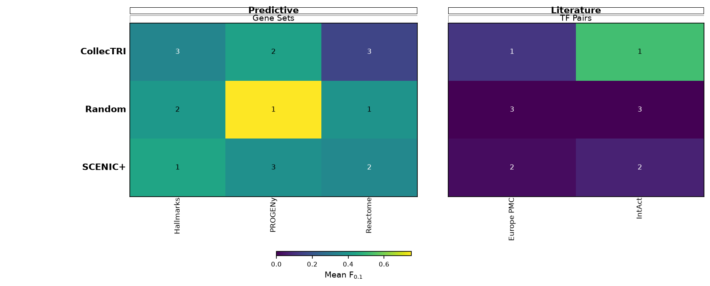

# Cardiac pseudobulk: TF activity, GRN comparison and MOON

Three scripts use the supplied cardiac RNA subset and SCENIC+ TF–gene network:

1. **[01_tf_activity.py](01_tf_activity.py)** — estimate CollecTRI TF activities from gene-wise Z-scores across six cell-type pseudobulks.
2. **[02_grn_comparison.py](02_grn_comparison.py)** — compare SCENIC+, CollecTRI and Random with GRETA; show the overall heatmap before category details.
3. **[03_moon.R](03_moon.R)** — infer upstream signaling hypotheses with **no upstream input** and **TF activities as downstream observations**.

The compact [heart_pseudobulk.h5ad](data/heart_pseudobulk.h5ad) is already prepared. A clone needs neither the original cells nor a path to anyone's Downloads folder. The original supplied [SCENIC+ table](data/scenicplus_grn.tsv) is preserved alongside it. Dataset source and SCENIC+ inference settings were not supplied; provenance records file hashes and what is known.

## Run the three scripts

Reuse the Python 3.12 environment from the GRN practical. From the repository root, activate it:

```bash
# macOS / Linux
source GRN_comparison/.venv/bin/activate
```

```powershell
# Windows PowerShell
.\GRN_comparison\.venv\Scripts\Activate.ps1
```

On this teaching Mac, set the existing GRN environment's OpenMP path before launching Python:

```bash
export DYLD_FALLBACK_LIBRARY_PATH="$(R RHOME)/lib:${DYLD_FALLBACK_LIBRARY_PATH:-}"
```

Then, from the repository root on either platform:

```bash
python Heart_pseudobulk/01_tf_activity.py
python Heart_pseudobulk/02_grn_comparison.py --download-resources --quick
Rscript Heart_pseudobulk/03_moon.R
```

The quick comparison skips the large external KnockTF resource. To include that diagnostic, run script 02 without `--quick`:

```bash
python Heart_pseudobulk/02_grn_comparison.py --download-resources
```

References are reused from `GRN_comparison/gretapy_data/`. First-time reference downloads need internet access; cached runs work offline. KnockTF occupies approximately 153 MB in the current cache. Without `--download-resources`, script 02 uses only available cached references and explicitly reports omissions. No reference downloads are needed for scripts 01 or 03.

For a new Python environment, the [GRN setup guide](../GRN_comparison/README.md#environment-and-first-run) provides the tested Python 3.12 installation. Alternatively install this folder's `requirements.txt` into a Python 3.12 virtual environment; it reuses the same dependency lock. **R and cosmosR are separate requirements** for script 03; see [MOON.md](MOON.md#install-the-r-environment-once). An existing environment running the NCI60 MOON example is sufficient. No optimization solver is used.

All paths default relative to the scripts, so the scripts also work when launched from this folder. Results go under `Heart_pseudobulk/results/`. The worked results, plots and run ledgers are included in Git so students can inspect them immediately after cloning; rerunning the scripts updates them. Source paths inside the saved ledgers describe the original run, while executable paths are resolved from the scripts. Python environments, reference-download caches and original single-cell h5ad files stay local. The NCI60 tutorial and its results are separate.

## What is in the compact h5ad?

| Item | Contents |
| --- | --- |
| Profiles | Six cell types, each pooling 100 cells from the supplied 600-cell subset |
| Genes | All 4,070 supplied genes; no further gene cap |
| `X` | Natural `log1p` of library-normalized pseudobulk counts |
| `layers['counts']` | Integer counts summed over cells of each type |
| `obs` | Cell type, cell count, donor/sample counts and count depth |
| `var` | Original gene symbols/Ensembl IDs, HVG/TF flags and detection counts |
| `uns` | Aggregation/normalization details, source checksum and donor composition |

The cell types are atrial cardiomyocytes, ventricular cardiomyocytes, endothelial cells, fibroblasts, mural cells and myeloid cells. The file has **6 × 4,070 values**, is approximately **0.44 MB**, and preserves the original **1,110,049 total counts** exactly in its counts layer. It contains no ATAC measurements or inferred GRN. Human heart identity is inferred from the supplied annotations and human gene IDs.

Pseudobulking sums **counts**, not log-expression or individual-cell Z-scores. Total retained-gene counts vary from 76,549 to 380,462 across the six groups. Each summed profile is normalized to 10,000 counts **over these 4,070 supplied genes**, then transformed with `log1p`. Full-transcriptome library totals are unavailable: the starting genes were already selected as 3,000 HVGs plus 1,295 TF-labelled genes, with 225 overlapping. This selected-gene normalization is a practical approximation, not a reconstruction of full-transcriptome normalization.

Donors are pooled within cell type and their contributions differ. The six profiles are descriptive teaching summaries, **not six biological replicates**, and are unsuitable for donor-level differential expression. The saved donor-composition table makes this explicit. The saved single-cell UMAP is not copied into the pseudobulk because its coordinates describe individual cells.

To regenerate the compact file from the original integer-count RNA file:

```bash
python Heart_pseudobulk/01_tf_activity.py --cells /path/to/rna.h5ad
```

This verifies integer/nonnegative input, sums by `obs['cell_type']`, checks per-gene count conservation, writes the compact file and its [provenance](data/pseudobulk_provenance.json), then estimates activities. `--prepare-only` stops after preparation. The input file is never modified.

## 1. What does TF activity mean here?

For each gene, subtract its mean log-normalized expression across the **six cell types**, then divide by its **sample SD (`ddof=1`)** across those types. A positive RNA Z-score therefore means higher expression than that gene's six-type average. Measured zero counts remain valid values; they are not missing data. Constant genes would become unavailable.

The script reuses the tested [NCI60 Python helper](../scripts/tf_activity_decoupler.py), local CollecTRI snapshot and signed **ULM** method. Each cell type is scored separately, using every available gene as the background and requiring **at least 20 observed targets** per TF. `empty=False` preserves genuine zero Z-scores. The prepared input produces **180 TFs × 6 cell types = 1,080 activity estimates**.

The activity is the slope's **t-statistic**: it measures alignment between signed TF-target weights and gene Z-scores, relative to zero-weight background genes. Its sign describes the inferred target footprint, rather than the TF's own RNA abundance. Changing the set of reference cell types changes the scores. Raw and within-profile BH-adjusted p-values describe the gene-level model, not donor-level replication or causal proof.

Start with `results/tf_activity/tf_activity_heatmap.png`: it shows original ULM scores for 20 variable TFs without rescaling TF rows. All scores are retained in `tf_scores.csv`. The outputs also include `rna_scaled.csv`, normalized RNA, summed counts, p-values, target coverage and donor composition. MOON reads these CSVs directly.

## 2. How should the GRN comparison be read?

Start with `results/grn_comparison/full/01_ranking_task.png`, then inspect the category figures and tables. The network comparison uses **log-normalized pseudobulk RNA**, not the gene-wise Z-scores used for TF estimation.



The raw SCENIC+ table contains 35,268 rows and 102 TFs. Its `type` supplies the sign; the positive supplied `score` is multiplied by +1 or −1. Its exact statistical interpretation and the meaning of `n_topics` are not established by the file. **594 TF–gene pairs carry both signs**: all 1,188 rows for those pairs are excluded, with an audit table, rather than arbitrarily selecting a sign. The original table remains intact.

The primary comparison restricts sources to TFs with at least **three measured nonself targets in both SCENIC+ and CollecTRI**. This yields **79 shared TFs**, 27,540 SCENIC+ edges and 2,641 CollecTRI edges. This three-target benchmark threshold is separate from the 20-target TF-activity threshold in script 01. Random has each SCENIC+ TF's outgoing degree and signed-score distribution, with targets sampled without replacement. It is one illustrative seeded control, not a complete null distribution.

GRETA requires source and target genes in the supplied RNA matrix. In contrast, script 01 can estimate a TF through its target footprint even when the TF's own transcript is unmeasured. The two scripts therefore use different eligible TF sets for different questions.

Because full SCENIC+ is much denser, a second comparison in `degree_matched/` uses the smaller per-TF edge budget for every method. It retains the strongest SCENIC+ edges and uses seeded sampling to break ties in CollecTRI. Read this sensitivity analysis alongside the full networks: density, target coverage and edge selection all influence scores.

| Evaluation | Question and interpretation |
| --- | --- |
| Gene Sets | **Do pathways whose genes are relatively highly expressed also appear as enriched labels somewhere among TF target sets?** It compares pathway-label lists, not individual regulatory edges. Counts, pathway calls, precision and recall are exported. |
| TF Pairs | Do TFs with significantly shared targets form reference-supported associations? This examines target organization and is sensitive to network size and reference coverage. |
| TF Markers | Are source TF identities supported by the marker resource? All three networks deliberately have the same sources, so these are invariant diagnostics excluded from ranking. |
| KnockTF scoring, optional | Does a network recover lower TF activity in external knockdowns? Heart filtering leaves only five eligible experiments, of which two are testable here, both targeting ETS1 in fibroblasts. Native scores are retained, but the default ranking requires at least ten tested experiments per method; this task is a low-coverage diagnostic for this dataset. |
| RNA prediction (`Gene ~ TFs`) | Omitted: six pooled profiles cannot support the native stratified train/test regression evaluation and minimum held-out sample count. It is not reported as a failed test or zero. |
| ATAC / genomic tasks | Omitted: the supplied GRN is a TF–gene projection, with no region-level evidence. |

The ten-experiment KnockTF gate is an explicit teaching safeguard, not a universal statistical threshold; `--min-knocktf-tests` changes it. Marker scores and limited perturbation scores remain visible in the diagnostic tables. `coverage.tsv`, `task_counts.tsv`, `evaluation_all.tsv`, and `excluded_from_ranking.tsv` should be read together. Reference terms are explicitly heart-related.

**F₀.₁ strongly favors precision**, so a method can score highly while recovering few reference items. Native GRETA Gene Sets also uses a fixed 20,000-gene enrichment background; our eligible target universe is only 4,070 selected genes. The separate `03_gene_sets_background.png` repeats network-side enrichment with restricted memberships and the eligible nonself universe. This sensitivity does not establish a universally correct benchmark or guarantee Random ranks last. For example, Random can recover just one RNA-supported PROGENy label and still obtain high F₀.₁. Inspect the counts before interpreting the color.

SCENIC+ may have been inferred from the full parent dataset, including these cells. This is a **descriptive consistency/reference comparison**, with no claim of independent held-out validation. CollecTRI self-reference agreement is excluded. Genes absent from the supplied selected subset are unmeasured, not established to be unexpressed. See the [existing task interpretation guide](../GRN_comparison/TASKS.md) for the native task definitions and aggregation.

## 3. What does the MOON run explain?

The default example is **Ventricular Cardiomyocyte**. Run every type with:

```bash
Rscript Heart_pseudobulk/03_moon.R --all
```

MOON receives the CollecTRI TF activity scores as downstream observations, with `upstream_input=NULL`. It scores up to four levels of possible upstream signaling regulators using the bundled protein/complex PKN. RNA is an annotation, not a direct protein-activity input. The PKN is not restricted to the 4,070 selected genes, since this would remove unmeasured intermediates without evidence of absence.

The script protects observed TF identifiers during compression and saves complete mappings and scoring networks. Its explicit extraction retains signed, consecutive-layer paths to observed TFs and audits every displayed node. The NCI60 reducer cannot be used unchanged because it expects upstream seeds. It also does not repeat the NCI60 RNA coherence loop on signaling edges: no separate transcript-level regulatory layer has been added here.

The ventricular example retains **44 downstream TFs**, realizes four inferred levels, and produces **605 displayed nodes and 703 edges** at the default display cutoff. Every inferred displayed node reaches an observed TF; 15 observed TFs have no surviving explanatory edge and are explicitly retained as isolated observations. Outputs include original-ID `SIF.csv`/`ATT.csv`, full scores, coverage, threshold sensitivity, plots and a run ledger in `results/moon/Ventricular_Cardiomyocyte/`. The `abs(TF)>2` and `abs(MOON)>1.5` cutoffs are heuristics, not FDR thresholds. Read [MOON.md](MOON.md) for the mapping, package setup and extraction details.

These are prior-compatible upstream hypotheses. There is no measured upstream anchor, perturbation validation or proof that an inferred regulator causes a cell-type difference.

## Verification and method references

All three scripts were executed on the supplied data, including MOON for all six types. Aggregation tests preserve each gene's total exactly, verify library normalization and sample-SD scaling, and reject already logged input. The GRN checks cover opposing signs, matched degrees, signed random controls and ranking gates; native pathway counts are checked against GRETA scores. MOON checks signs, input protection and directed paths to level-0 TFs.

```bash
python -m pytest Heart_pseudobulk/tests scripts/test_tf_activity_decoupler.py
Rscript Heart_pseudobulk/test_moon.R
```

- [decoupler pseudobulk tutorial](https://decoupler.scverse.org/en/latest/notebooks/scell/rna_psbk.html) — distinguishes sample-level pseudobulks with replication from pooled teaching profiles.
- [Library-size normalization](https://scanpy.readthedocs.io/en/stable/generated/scanpy.pp.normalize_total.html).
- [ULM method](https://decoupler.scverse.org/en/latest/api/generated/decoupler.mt.ulm.html).
- [GRETA evaluation tutorial](https://gretapy.readthedocs.io/en/latest/notebooks/eval.html).
- [Input data provenance](data/pseudobulk_provenance.json) and [SCENIC+ provenance](data/scenicplus_provenance.json).
